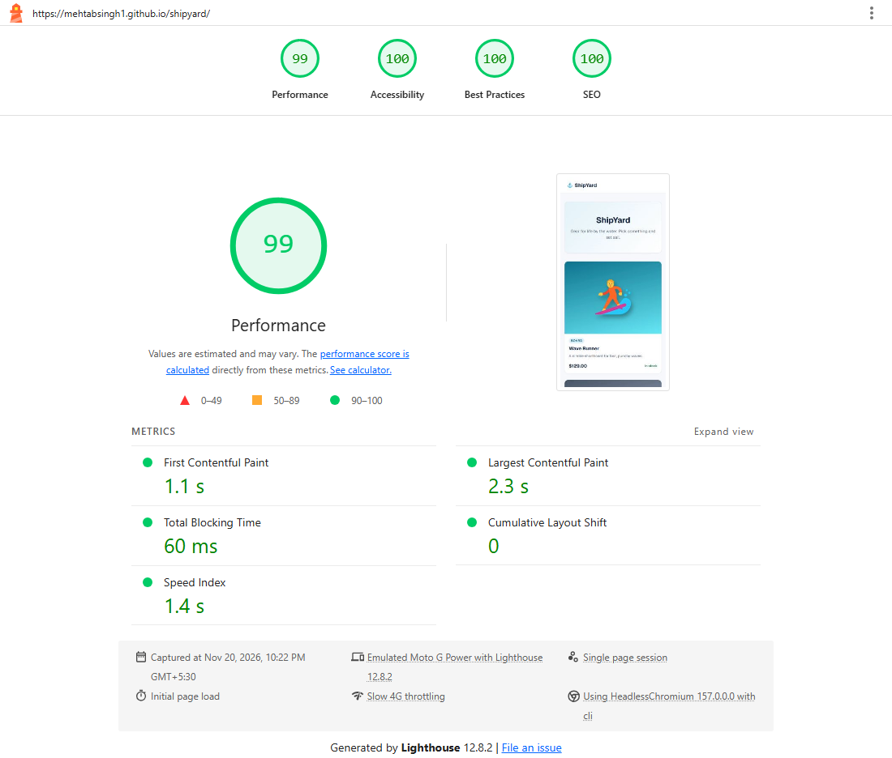
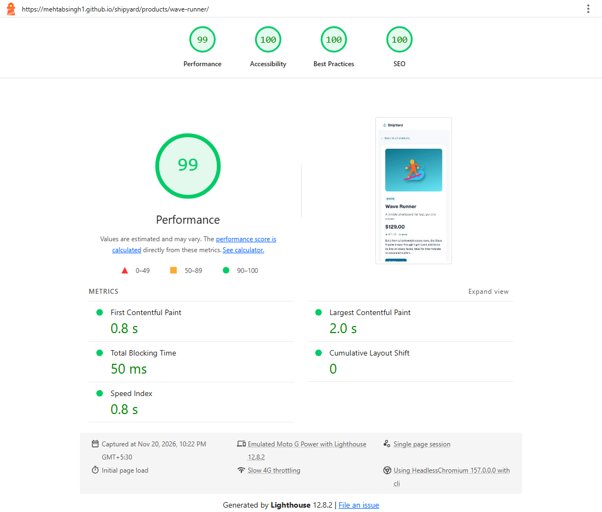
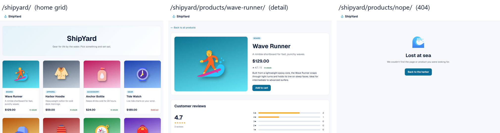

# ShipYard

A small product-catalog storefront built with **Next.js (App Router) + TypeScript**, statically exported and deployed to GitHub Pages.

- **Live site:** https://mehtabsingh1.github.io/shipyard/
- **Repository (public):** https://github.com/MEHTABSINGH1/shipyard

## Lighthouse (Mobile)

| Page | Performance | Accessibility | Best Practices | SEO | Full report |
| --- | --- | --- | --- | --- | --- |
| Home `/` | **99** | 100 | 100 | 100 | [HTML report](https://mehtabsingh1.github.io/shipyard/lighthouse/home.html) · [Lighthouse Viewer](https://googlechrome.github.io/lighthouse/viewer/?jsonurl=https%3A%2F%2Fraw.githubusercontent.com%2FMEHTABSINGH1%2Fshipyard%2Ffeature%2Fdeploy%2Fdocs%2Flighthouse%2Fhome.json) |
| Product `/products/wave-runner/` | **99** | 100 | 100 | 100 | [HTML report](https://mehtabsingh1.github.io/shipyard/lighthouse/product.html) · [Lighthouse Viewer](https://googlechrome.github.io/lighthouse/viewer/?jsonurl=https%3A%2F%2Fraw.githubusercontent.com%2FMEHTABSINGH1%2Fshipyard%2Ffeature%2Fdeploy%2Fdocs%2Flighthouse%2Fproduct.json) |

Run against the **live GitHub Pages URL** with Lighthouse 12.8.2, **mobile** form factor (Emulated Moto G Power, Slow 4G throttling), on 20 Nov 2026.
- **Home:** FCP 1.1 s, LCP 2.3 s, TBT 60 ms, CLS 0.
- **Product:** FCP 0.8 s, LCP 2.0 s, TBT 50 ms, CLS 0.

The raw JSON results are in [`docs/lighthouse/`](docs/lighthouse/). To re-run it yourself, use [PageSpeed Insights (mobile)](https://pagespeed.web.dev/analysis?url=https%3A%2F%2Fmehtabsingh1.github.io%2Fshipyard%2F&form_factor=mobile).

The first measurement, on a local server without compression, scored 83. See the performance notes below.

| Home | Product detail |
| --- | --- |
|  |  |

## Live routes (verified)

| Route | Expected | Result |
| --- | --- | --- |
| [/shipyard/](https://mehtabsingh1.github.io/shipyard/) | Product grid, 8 cards with images | 200 ✅ |
| [/shipyard/products/wave-runner/](https://mehtabsingh1.github.io/shipyard/products/wave-runner/) | Product detail + lazy-loaded reviews | 200 ✅ |
| [/shipyard/products/dry-bag/](https://mehtabsingh1.github.io/shipyard/products/dry-bag/) | Another statically built product | 200 ✅ |
| [/shipyard/products/nope/](https://mehtabsingh1.github.io/shipyard/products/nope/) | Friendly "Lost at sea" 404 | 404 ✅ |
| [/shipyard/products/wave-runner.webp](https://mehtabsingh1.github.io/shipyard/products/wave-runner.webp) | Product image under basePath | 200 ✅ |



## Routes

- `/` – responsive grid of products (`app/page.tsx`)
- `/products/[id]/` – one statically pre-built detail page per product (`app/products/[id]/page.tsx`)
- Unknown ids (e.g. `/products/nope/`) show a friendly 404 (`app/not-found.tsx`)

## Structure

| File | Purpose |
| --- | --- |
| `app/data/products.ts` | `Product` type, typed `products` array, `getProduct(id)` helper |
| `app/components/ProductCard.tsx` | Reusable card, takes a typed `product` prop, links to its detail page |
| `app/page.tsx` | Maps products into a CSS grid (`repeat(auto-fill, minmax(240px, 1fr))`) |
| `app/products/[id]/page.tsx` | Dynamic route with `generateStaticParams`, `generateMetadata` and `notFound()` |
| `app/products/[id]/LazyReviews.tsx` | `next/dynamic` wrapper that lazy-loads the Reviews panel |
| `app/loading.tsx` | Skeleton shown while a route loads |
| `app/error.tsx` | Client error boundary with a "Try again" button |
| `app/not-found.tsx` | Friendly 404 page |
| `next.config.ts` | `output: "export"`, `basePath: "/shipyard"`, unoptimized images |
| `.github/workflows/deploy.yml` | Builds the static site and publishes `out/` to GitHub Pages |

## Performance work

- **Images:** real WebP images in `public/products/`, rendered with `next/image` (width/height on cards, `fill` in a sized parent on the detail page) with `alt` text. The above-the-fold (LCP) images use `preload` (Next 16's replacement for `priority`); the rest lazy-load. CLS is 0.
- **Fonts:** Geist via `next/font/google`, self-hosted and applied with `className`, with no Google Fonts `<link>`.
- **Lazy loading:** the below-the-fold Reviews panel (uses `localStorage`) is loaded with `next/dynamic` and `{ ssr: false }` from a Client Component, with a skeleton fallback.
- **Metadata:** title template in the layout, a `metadata` export on the home page, and `generateMetadata` per product (title, description, Open Graph image).
- **Static-export fix:** `scripts/flatten-prefetch.mjs` (run as `postbuild`) copies Next 16's nested prefetch payloads to the flat filenames the router requests, so client navigation prefetches don't 404 on GitHub Pages.

## Run locally

```bash
npm install
npm run dev      # http://localhost:3000/shipyard
npm run build    # static export to out/
```

To preview the static build exactly as GitHub Pages serves it (under `/shipyard`), copy `out/` into a folder named `shipyard/` and serve its parent, e.g. `npx serve preview` with `preview/shipyard/` = `out/`, then open http://localhost:3000/shipyard/.

## Deploy

Pushing to `main` runs `.github/workflows/deploy.yml`, which runs `npm ci && npm run build` and publishes `out/` to GitHub Pages (Settings → Pages → Source: **GitHub Actions**).
